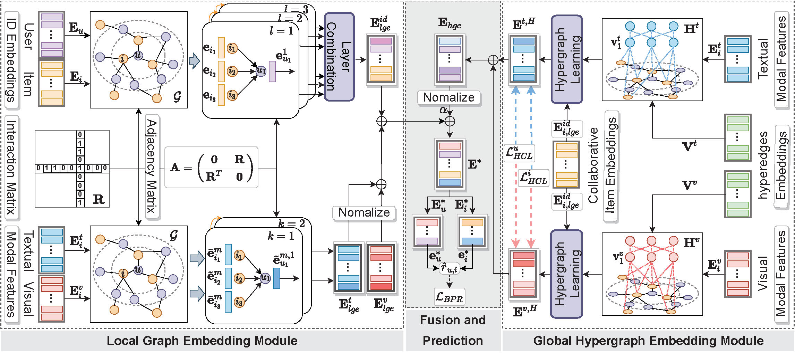

# LGMRec / LGMRecOpt 研究仓库

## 新实验入口（2026-10）

LGMRecOpt 是 LGMRec 的透明扩展，目前实现的是待验证研究框架，不代表已获得稳定提升。
仅保留两个研究模块：超边级个性化多兴趣匹配、TRAIN 留出行为驱动的超边分工排序监督。
旧 `models/lgmrec.py`、`main.py` 及历史数据保留不动；旧入口的协议不适用于新实验。

新代码直接放在现有目录，没有嵌套仓库：

- `models/lgmrecopt.py`：干净的 LGMRec 参考类及直接继承它的 LGMRecOpt。
- `run_experiment.py`：统一训练、验证选模和最终冻结评估。
- `configs/model/LGMRecOpt.yaml`：共同参数与新模块初始参数，不是已调优配置。
- `tests/test_framework.py`：合成数据微型测试，不使用真实 TEST 标签。

构建验证（2026-10-09）：24 项测试通过，包含 CUDA 微型训练；另在已有 Baby 数据上完成
baseline / slots / full 各一次 GPU 训练步和小块评分检查。未做完整效果实验，未评估真实 TEST。

### 环境和数据

沿用下方原项目依赖；建议 Python 3.10/3.11，先安装匹配服务器驱动的 PyTorch。
微型测试另需 `pip install pytest`。每个数据目录需要：

```text
data/baby/baby.inter
data/baby/image_feat.npy
data/baby/text_feat.npy
```

Sports、Clothing 同理。交互文件列为 `userID,itemID,x_label`（TAB 分隔），划分标签为
TRAIN=0、VALID=1、TEST=2；特征行号必须和物品 ID 一致。
也可用 `--data-dir /existing/path/baby` 直接读取已有数据，不必复制大文件。

### 首轮命令

```bash
python -m pytest tests/test_framework.py -q -p no:cacheprovider

# 先完成基线、去 HCL 对照、多兴趣、完整模型的同协议配对实验。
python run_experiment.py --dataset baby \
  --data-dir /path/to/data/baby \
  --output data/runs/baby-slots-r1 \
  --variants baseline baseline_no_hcl slots full \
  --seeds 999 2026 2027 --device cuda
```

一次命令只运行指定的数据集。`--epochs 2` 可作流程冒烟测试，不应当作效果实验。
修改参数请在运行前编辑配置，或通过 `--config` 指定配置；每次运行都会保存完整解析结果。

### 消融定义

| variant | 含义 |
|---|---|
| baseline | LGMRec 参考模型，保留原 HCL |
| baseline_no_hcl | 去掉 HCL 的参考模型，隔离损失变化的影响 |
| slots | 候选条件多兴趣评分，无 HCL、无辅助损失 |
| slots_hcl | 多兴趣评分 + 原 HCL |
| full | 多兴趣评分 + 留出超边分工监督，无 HCL |
| fixed | 相同兴趣表示但固定加权评分，无辅助损失 |
| masked | 多兴趣 + 普通留出 BPR，替代分工监督 |
| uniform | 多兴趣 + 通道均匀分工监督 |
| no_global | 完整模型去掉全局超边原型补充；仍保留模态超边归属，不是完全无超图 |
| random_structure | 打乱物品与模态超边的对应关系，保留归属分布形状 |

第一模块用 TRAIN 历史在每个模态的超边上聚合个性化兴趣，加上归一化全局原型后，
通过带历史先验的 log-sum-exp 匹配候选。两个模态独立读出后相加，不按槽位索引跨模态对齐。
辅助模块每批从每个至少有两条 TRAIN 交互的用户中选一个正例，从整个辅助图移除该交互，
重新计算 CGE/MGE/GHE；责任权重为支持历史先验与正例超边归属的乘积，停止梯度后用于分通道 BPR。
它不是独立教师或因果估计，归属是软监督代理；也不保证避免兴趣坍缩。
全图主任务仍使用全部 TRAIN，辅助视图的留出不意味着该正例从整个训练过程永久不可见。

参考模型按 LGMRec 方程实现；相对作者发布代码使用确定性评估、稳定 logsumexp HCL 和公共稀疏 API。
本仓库旧模型已有额外变换与归一化，不能当作这里的干净参考。
两类新模型无额外可训练参数；优化模型正则作用于实际评分使用的局部表示，参考模型作用于最终融合表示。
这些实现差异必须披露，不能宣称与旧版本日志逐位复现；应重新跑同协议对照。

### 实验边界与结果位置

- 构图、负采样、辅助任务只用 TRAIN。训练负例不会利用 VALID/TEST 过滤。
- VALID 按配置中的完整精度指标选模，默认 Recall@20；TEST 不随训练调用。
- 所有用户全物品排序，验证屏蔽 TRAIN，最终测试屏蔽 TRAIN+VALID；过滤训练中未出现的评估用户。
- 公共配置、数据 SHA256、代码指纹、种子均记录。CUDA 稀疏算子可能非逐位确定，多种子比较仍必要。
- 输出目录必须全新；不覆盖旧日志、配置或检查点。
- 检查点不包含原始图文特征和 TRAIN 图，仅保存模型参数及冻结配置指纹。
- 一次评估仅编码全图一次，评分分块，不构造完整的用户×物品×兴趣×维度张量。
- `full` 每批多一次支持图编码，评分随兴趣数量增加，不能假定与原模型等速。

每次结果在 `--output/<variant>-seed<seed>/`：
`manifest.json`（参数和指纹）、`metrics.jsonl`（逐轮损失与验证）、`status.json`（最佳验证结果）、
`diagnostics.json`（最佳轮超边占用与熵）、`best.pt`（最佳参数）。总目录有 `summary.json`。
回传日志时可跳过 `best.pt`；服务器仍应保留它用于最终冻结评估。

所有实验选择完成后，对已冻结的某次运行执行一次：

```bash
python run_experiment.py --evaluate-frozen data/runs/baby-slots-r1/full-seed999 \
  --confirm-final --device cuda
```

该操作校验代码、配置、数据与检查点指纹，生成 `test.json` 并锁定这次运行，禁止再次评估。
不要删锁或复制运行目录来反复查看 TEST。若在其他机器评估，可加 `--data-dir` 指向相同指纹的数据。

下面保留原项目说明与引用。新实验不要使用其中的旧训练命令。

---

## LGMRec (AAAI'24) 原始说明

This is the Pytorch implementation for our AAAI 2024 paper:
>Zhiqiang Guo, Jianjun Li, Guohui Li, Chaoyang Wang, Si Shi, Bin Ruan. LGMRec: Local and Global Graph Learning for Multimodal Recommendation. In AAAI 2024. [Paper](https://ojs.aaai.org/index.php/AAAI/article/view/28688)

Notice: The results of the baseline MMGCN have been updated in our [new version](https://arxiv.org/abs/2312.16400).

### Overview



### Environment

pip install -r requirements.txt

### Data

Download from Google Drive: [Baby/Sports/Clothing](https://drive.google.com/drive/folders/1BxObpWApHbGx9jCQGc8z52cV3t9_NE0f?usp=sharing).
The data contains text and image features extracted from Sentence-Transformers and VGG-16 and has been publiced in [MMRec](https://github.com/enoche/MMRec) framework.

### Run

1. Put your downloaded data (e.g. baby) under `data/` dir.
2. Run `train.sh` to train LGMRec:
  `bash train.sh`
You may specify other parameters in CMD or config with `configs/model/*.yaml` and `configs/dataset/*.yaml`. 

### Citation

    @inproceedings{guo2024lgmrec,
    author = {Zhiqiang Guo and Jianjun Li and Guohui Li and Chaoyang Wang and Si Shi and Bin Ruan},
    title = {LGMRec: Local and Global Graph Learning for Multimodal Recommendation},
    booktitle = {Proceedings of AAAI 2024},
    pages = {8454-8462},
    year = {2024}
    }

The code has been integrated into the [MMRec](https://github.com/enoche/MMRec) repository.
